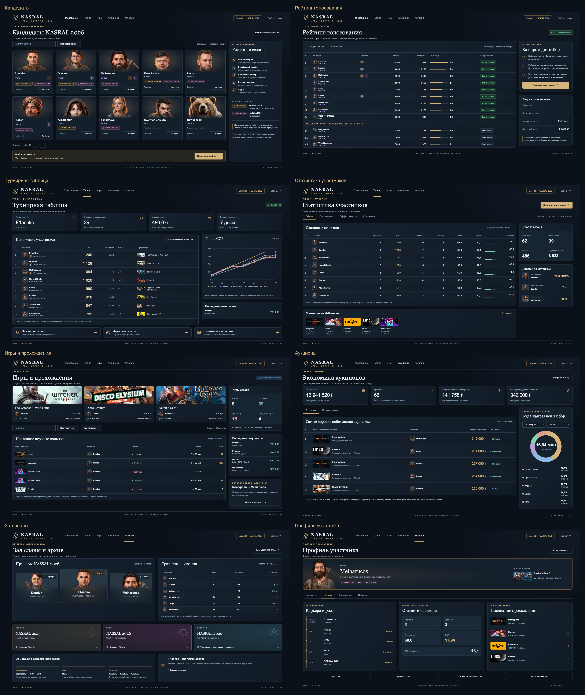

# NASRAL — история, статистика и достижения

**История участников и комьюнити — часть самого ивента.**

За годы NASRAL и других игровых ивентов накопились победы, провалы, рекорды, прохождения и памятные аукционы. Сейчас многое живёт по принципу «кто помнит, тот помнит». Эту историю можно показать на сайте: в регалиях, эмблемах сезонов, профилях участников и Зале славы.

Как в NBA, HLTV и футбольных клубах: прошлые результаты помогают узнать участника, сравнить его с другими и увидеть, как меняется его карьера. Следующий сезон добавляет новую главу к общей истории.

## Участники и голосование

В [карточке кандидата](renders/01_candidates.png) видны портрет, прошлые сезоны и достижения. По значку можно узнать, за что он получен, по имени — открыть профиль. [Рейтинг голосования](renders/02_voting.png) показывает места и проходной порог, а [проверка состава](renders/12_vote_selection.png) — выбранных участников и фаворита.

## Турнир, игры и аукционы

[Турнирная таблица](renders/03_standings.png) показывает гонку по GGP, текущие игры и изменения мест. В [статистике](renders/04_statistics.png) можно сравнить прохождения, дропы, время и темп, а [два участника рядом](renders/09_comparison.png) помогают увидеть разницу без переключения страниц.

[Игры](renders/05_games.png) и [аукционы](renders/06_auctions.png) связаны друг с другом. У каждого назначения есть [своя история](renders/10_auction_to_result.png): какие варианты предложили зрители, сколько поставили, что выбрали, сколько длилось прохождение и чем оно закончилось. Из результата можно перейти к очкам, участнику и записи.

## История и Зал славы

[Зал славы](renders/07_hall_of_fame.png) собирает чемпионов, сезоны и сравнение итоговых мест. [Архив сезона](renders/11_season_archive.png) сохраняет его состав и результаты. В [профиле участника](renders/08_participant_profile.png) видна карьера: где он играл, какие места занимал, когда был судьёй и какие игры проходил.

HPG, UPG, MGE и Стримхаты дополняют общую историю комьюнити. У NASRAL/NASSAL при этом остаются собственные сезоны и титулы.

## Все экраны

Обзор открывается в полном размере. Каждый экран выше доступен отдельно; [подробные состояния](renders/details_overview.jpg) также собраны на одном листе.

Поведение экранов, значков, фильтров и переходов описано в [ТЗ](SPEC.md).

Очки, голоса, время и суммы в макетах взяты для примера. Результаты прошлых сезонов — из архива.
